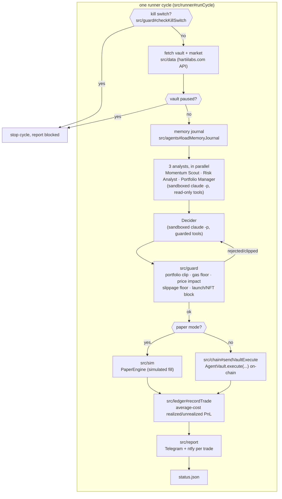

# hartii-agent-trader

An open-source, standalone harness for running an autonomous **multi-agent AI trading
system** against [HartiiLabs](https://hartiilabs.com) — a memecoin launchpad on Quai Network
mainnet — through an on-chain **AgentVault** (a smart-contract wallet whose spending caps are
enforced on-chain, not by the bot).

This repo is **clean-room**: it talks only to the public `https://hartiilabs.com` HTTP API
(documented at [`/llms.txt`](https://hartiilabs.com/llms.txt) and
[`/api/agent/manifest`](https://hartiilabs.com/api/agent/manifest)) and to public, verified
contracts on [Quaiscan](https://quaiscan.io). It contains no code from, and does not import,
any private Hartii repository.

> **Status.** Built module-by-module against the frozen contracts in
> [`INTERFACES.md`](./INTERFACES.md), each with its own `node:test` suite that never touches the
> network (every dependency — `fetch`, the RPC provider, `spawn`, the filesystem — is injected).
> `src/runner`, `src/report`, `src/sim` and `bin/` are implemented and tested end to end via
> injected fakes for their dependencies. Whether the *whole* pipeline can run a real cycle right
> now depends on every other `src/*` module also being finished — check each module's own header
> comment (a stub still throws `not implemented — see INTERFACES.md`) for its current state.
> **Paper mode is the only mode that can ever run** until a real `HARTII_AGENT_KEY` is configured
> *and* `--live` is explicitly passed on the command line (see [Safety model](#safety-model)) —
> there is no path in this repo that reaches `src/chain`'s transaction-sending functions
> otherwise.

## What this is

Each trading cycle, several cheap, sandboxed, **read-only** AI analysts run in parallel
(Momentum Scout, Risk Analyst, Portfolio Manager), each returning a strict-JSON list of trade
proposals. A Decider agent (with narrow, guarded trade tools) reconciles those into 1-3
actions. Every action still passes through **code-enforced guards** (portfolio-fraction clip,
gas floor, price-impact ceiling, slippage floor, launch/NFT blocks, kill switch) before
anything reaches the chain — the model's judgment is never the trust boundary, the code is.

Two risk profiles ship: `reckless` (default — trade every cycle, size boldly on conviction,
fast rotation) and `balanced`. See `src/config` and `briefs/`.



Each analyst/decider box is a fresh, sandboxed `claude -p` subprocess with **no file, shell, or
web access** — only the narrow MCP tool set `resolveAllowlist` picks for its role, served by a
freshly-spawned `bin/mcp-server.mjs --role <role>` over stdio (a new OS process every time; see
`INTERFACE-REQUESTS.md` for why paper state is reconstructed from `state/ledger.json` on every
spawn rather than held in memory).

`runLoop` (`src/runner#runLoop`) calls `runCycle` repeatedly with a jittered ~20-60s pause
between cycles, and stops the whole session on: the kill-switch file, the agent EOA's gas
balance dropping below a configured floor, the vault's total value dropping below a
"capital exhausted" dust threshold, the vault reporting `paused`, a max session duration, or
too many consecutive cycle failures.

## Safety model

- **Paper mode by default, and it's the only mode that can run today.** `--paper` (or no real
  key configured) simulates fills against live quotes via `src/sim`'s `PaperEngine` — nothing is
  signed or sent. Live mode additionally requires an explicit `--live` flag on `bin/run.mjs`
  *and* a real key: a key being present in the environment is never, on its own, enough to start
  sending transactions.
- **No secrets in the repo, ever.** All credentials come from environment variables — see
  [Environment variables](#environment-variables) below. `.env*`, `*.key`, `state/`, `logs/`,
  and `sandbox/` are gitignored.
- **On-chain caps are the real backstop.** `AgentVault.execute` only reaches allow-listed
  Hartii contracts, can never move ERC-20 tokens out of the vault, and enforces its own
  per-transaction and rolling-24h QUAI caps — independent of anything this code does.
- **Code-level guards run before every trade is built**, in `src/guard/` (pure functions, no
  I/O, fully unit-testable): a hard 40%-of-portfolio clip, a 5x-estimated-gas floor, a
  price-impact ceiling, a mandatory slippage floor, a launch-gate (off by default) and an
  **unconditional NFT-deploy block** — no config flag changes that last one.
  `src/runner#shouldStop` adds session-level backstops on top: kill switch, agent-EOA gas floor,
  vault-paused, and capital-exhausted.
- **Untrusted on-chain/API text never becomes instructions.** Token names, symbols and
  descriptions are data the model reasons *about*, never text it follows — `src/data#sanitizeTokenText`
  strips/truncates every free-text field before it reaches a prompt.
- Token launches are off unless you opt in (`HARTII_LAUNCHES_ENABLED=1`); the agent never
  invents its own launch images (an owner-curated URL pool is required).
- This is genuinely risky software if you point it at a funded vault with the `reckless`
  profile — that risk is the point (fast, high-conviction, high-turnover trading is the explicit
  design goal here, not a bug), but it is **your** risk to take with **your** funds.

> **Disclaimer.** This is experimental software controlling a wallet that can hold real funds.
> It has bugs. Markets it trades are extremely volatile and can go to zero. Nothing in this
> repository, its briefs, or its output is financial advice. Run it in paper mode first, read
> every guard in `src/guard/`, and only ever risk funds you can afford to lose completely.

## Layout

```
src/config/   profiles (reckless, balanced), env loading/validation, constants
src/chain/    provider, address utils, minimal ABIs, vault execute calldata builders, gas, receipts, balances
src/data/     public HartiiLabs API client (market, token detail, trades, candles, holders, quotes, vault state)
src/tools/    MCP server(s): read-only intelligence tools + guarded trade tools, allowlist builder
src/guard/    pure guard math (portfolio clip, gas floor, impact, slippage, launch/NFT blocks)
src/ledger/   trade ledger, average-cost realised/unrealised PnL, deposits, gas accounting
src/agents/   multi-agent cognition: analyst + decider runners, prompts/briefs, JSON parsing, memory journal
src/runner/   cycle orchestration, loop, stop conditions, status.json, paper-mode switch
src/report/   Telegram + optional ntfy formatting/sending/throttling
src/sim/      paper-trading engine + replay/eval over public trade history
bin/          keygen.mjs, run.mjs, status.mjs, mcp-server.mjs (spawned automatically by src/agents — see below)
briefs/       knowledge + per-role prompts (markdown, public HartiiLabs mechanics only)
test/         node:test suites, one file per src/ + bin/ module
```

See [`INTERFACES.md`](./INTERFACES.md) for exact exports, JSON contracts, MCP tool schemas,
the ledger schema, and every environment variable. See
[`INTERFACE-REQUESTS.md`](./INTERFACE-REQUESTS.md) for a couple of integration details the
runner/report/sim build had to make a judgment call on (thin `DeciderResult.actions` fields, the
cycle-pacing knobs, gas/capital-exhausted thresholds) that the owning modules should reconcile.

## Environment variables

| Var | Required | Purpose |
|---|---|---|
| `HARTII_AGENT_KEY` or `HARTII_AGENT_KEY_FILE` | for live mode only | agent EOA private key (raw or path to a key file, e.g. from `bin/keygen.mjs`) — never required in paper mode |
| `HARTII_VAULT_ADDRESS` | yes (live) | the AgentVault this bot trades through |
| `TELEGRAM_BOT_TOKEN` | for reporting | Telegram bot token |
| `TELEGRAM_CHAT_ID` | for reporting | Telegram chat/channel to report to |
| `NTFY_URL` | optional | extra push notification target (a full `https://ntfy.sh/<topic>`-style URL) |
| `HARTII_API_BASE` | no | default `https://hartiilabs.com` |
| `HARTII_RPC_URL` | no | default `https://rpc.quai.network/cyprus1` |
| `HARTII_PROFILE` | no | `reckless` (default) or `balanced` |
| `HARTII_PAPER` | no | `1` forces paper mode regardless of keys |
| `HARTII_DRY_RUN` | no | `1` builds/logs intended calldata, never sends |
| `HARTII_MAX_ACTIONS_PER_CYCLE` | no | default `3` |
| `HARTII_LAUNCHES_ENABLED` | no | `1` to allow the (off-by-default) launch tool |
| `HARTII_KILL_SWITCH_FILE` | no | default `state/STOP` — create this file to stop a running loop |
| `HARTII_STATE_DIR` | no | default `state/` — base dir for status/ledger/memory/kill-switch |

Full list, defaults, and validation rules: [`INTERFACES.md`](./INTERFACES.md#env).

## Running

```sh
npm install
npm test                       # node:test, no network, every dependency injected

# 1. Generate a bot key (never your own wallet's key — this is a fresh, dedicated agent EOA):
node bin/keygen.mjs --out state/agent.key
# -> prints only the address. Fund THAT address with a little QUAI for gas once you're ready
#    for live mode; paper mode needs none of this.

# 2. Copy .env.example -> .env, fill in TELEGRAM_* / NTFY_URL as desired.
#    HARTII_PAPER=1 by default in .env.example — leave it set until you've watched a paper
#    session behave the way you expect. HARTII_VAULT_ADDRESS is optional in paper mode (nothing
#    paper does ever touches the real vault) — a brand new paper session auto-seeds a simulated
#    starting balance on its first run. Configuring a real (even unfunded) vault address anyway
#    gets you real on-chain gas estimates instead of an approximate fallback; see
#    INTERFACE-REQUESTS.md item 3 for the full paper-mode-without-a-vault design.

node bin/run.mjs --paper --once   # one paper cycle, prints the cycle result as JSON
node bin/run.mjs --paper --loop   # continuous paper session (jittered ~20-60s between cycles)
node bin/status.mjs               # pretty-print the last known state/status.json
npm start                         # node bin/run.mjs --loop (paper unless real keys + --live are set)

# Only once you've watched paper mode behave, funded the vault, and funded the agent EOA's gas:
node bin/run.mjs --live --loop
```

Stop a running loop at any time by creating the kill-switch file (default `state/STOP`) — the
next cycle boundary halts the session and sends a "blocked" report.

## Build plan (for parallel implementers)

The module boundaries in `INTERFACES.md` are frozen so multiple people/agents can build
against them without touching each other's folders:

1. `src/config` + `src/chain` + `src/data` — no dependencies on the rest, unblocks everyone else.
2. `src/guard` + `src/ledger` — pure logic, depend only on `src/config` types.
3. `src/tools` + `src/report` — depend on `src/data`, `src/chain`, `src/guard`.
4. `src/agents` + `src/sim` — depend on `src/tools`, `src/data`.
5. `src/runner` + `bin/` wires everything together last.

## License

MIT — see [`LICENSE`](./LICENSE).
